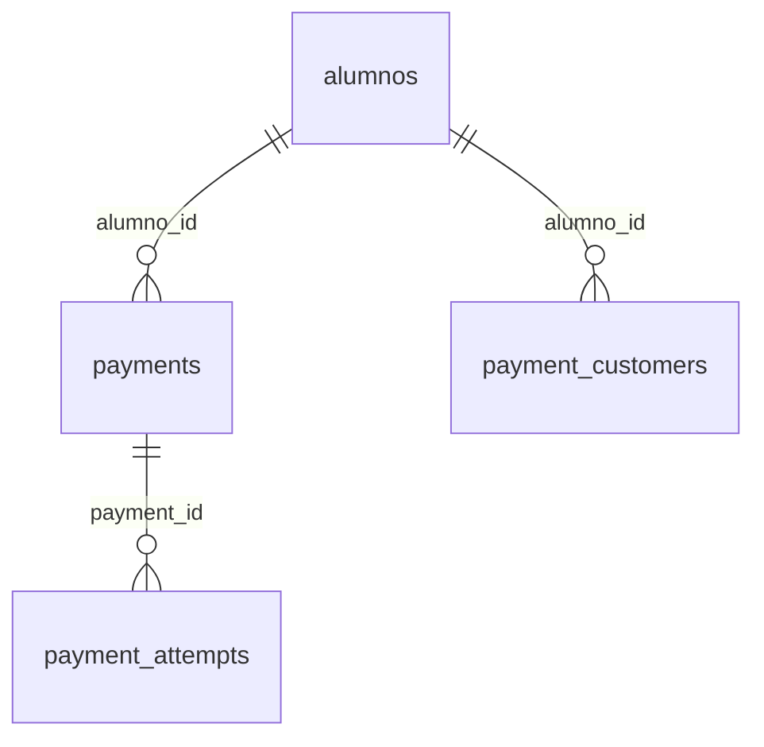

# Base de datos de pagos

Documentación del esquema de pagos móviles de School Control.

- Base de datos: `escolarprueba`
- Migración: `database/migrations/2026_11_11_000000_create_school_payment_tables.php`
- Pasarela actual: `stripe`
- Moneda de la demo: `mxn`
- Monto de la demo: `1000` centavos (`$10.00 MXN`)

## Diagrama

## `payments` — tabla principal

Registro principal del pago. Es la tabla que consulta la app para el historial.

| Campo | Tipo | Nulo | Clave | Notas |
|---|---|---|---|---|
| `id` | `char(36)` | No | PK | UUID del pago |
| `alumno_id` | `bigint unsigned` | No | índice | Referencia a `alumnos.idalumnos` |
| `amount_cents` | `int unsigned` | No | | Monto en centavos |
| `currency` | `char(3)` | No | | `mxn` |
| `status` | `varchar(24)` | No | índice | `pending`, `paid`, `failed`, `processing` |
| `gateway` | `varchar(32)` | No | | Pasarela usada; hoy `stripe` |
| `payment_method` | `varchar(32)` | Sí | | Hoy `card` |
| `description` | `varchar(255)` | No | | Concepto del pago |
| `provider_payment_id` | `varchar(255)` | Sí | único | ID del PaymentIntent (`pi_...`) |
| `paid_at` | `timestamp` | Sí | | Fecha de pago confirmado |
| `created_at` | `timestamp` | Sí | | Auditoría |
| `updated_at` | `timestamp` | Sí | | Auditoría |

Índices:

- `PRIMARY (id)`
- `UNIQUE (provider_payment_id)`
- `INDEX (alumno_id)`
- `INDEX (status)`

## `payment_customers` — cliente de la pasarela

Un registro por alumno y pasarela. Guarda el customer de Stripe.

| Campo | Tipo | Nulo | Clave | Notas |
|---|---|---|---|---|
| `id` | `bigint unsigned` | No | PK | Auto-incremental |
| `alumno_id` | `bigint unsigned` | No | índice | Referencia a `alumnos.idalumnos` |
| `gateway` | `varchar(32)` | No | índice | `stripe` |
| `provider_customer_id` | `varchar(255)` | No | | ID del customer (`cus_...`) |
| `created_at` | `timestamp` | Sí | | Auditoría |
| `updated_at` | `timestamp` | Sí | | Auditoría |

Índices:

- `PRIMARY (id)`
- `UNIQUE (alumno_id, gateway)` — un customer por alumno y pasarela
- `UNIQUE (gateway, provider_customer_id)`

## `payment_attempts` — intentos y datos específicos de Stripe

Cada intento de pago con su estado crudo de Stripe y metadata.

| Campo | Tipo | Nulo | Clave | Notas |
|---|---|---|---|---|
| `id` | `bigint unsigned` | No | PK | Auto-incremental |
| `payment_id` | `char(36)` | No | índice, FK | Referencia a `payments.id` |
| `gateway` | `varchar(32)` | No | | `stripe` |
| `provider_payment_id` | `varchar(255)` | Sí | índice | PaymentIntent (`pi_...`) |
| `status` | `varchar(24)` | No | índice | Estado crudo de Stripe (`succeeded`, `requires_payment_method`, etc.) |
| `failure_code` | `varchar(255)` | Sí | | Código de rechazo de Stripe |
| `metadata` | `json` | Sí | | Incluye `provider_payment_method_id` y datos del intento |
| `created_at` | `timestamp` | Sí | | Auditoría |
| `updated_at` | `timestamp` | Sí | | Auditoría |

Índices:

- `PRIMARY (id)`
- `INDEX (payment_id)`
- `INDEX (provider_payment_id)`
- `INDEX (status)`
- `FOREIGN KEY (payment_id) REFERENCES payments(id) ON DELETE CASCADE`

## Relaciones

- `payments.alumno_id` → `alumnos.idalumnos`
- `payment_customers.alumno_id` → `alumnos.idalumnos`
- `payment_attempts.payment_id` → `payments.id`

## Estados

`payments.status` se normaliza para la app:

| Estado | Significado |
|---|---|
| `pending` | Pago creado, aún sin confirmar |
| `processing` | Stripe lo está procesando |
| `paid` | Pago confirmado; aparece en “Mis pagos” |
| `failed` | Pago rechazado o cancelado |

`payment_attempts.status` conserva el estado original de Stripe.

## Uso desde la API móvil

- `POST /api/v1/mobile/payments` crea la fila en `payments` y el PaymentIntent.
- `POST /api/v1/mobile/payments/{id}/confirm` sincroniza el estado con Stripe.
- `GET /api/v1/mobile/payments` devuelve la tabla principal.
- La app solo muestra registros con `status = 'paid'`; los `failed` quedan como bitácora y no aparecen en el historial.
- `POST /api/v1/mobile/payment-methods` adjunta una tarjeta tokenizada al customer sin validar saldo.
- `GET /api/v1/mobile/payment-methods` lista las tarjetas del customer.

## Nota sobre `alumnos`

`alumnos` es una tabla existente. El modelo `Alumno` ahora usa:

- PK: `idalumnos`
- Campos de login móvil: `numestudiante`, `contrasena`
- Campo visible: `nombre`
- Sin `timestamps`
- `contrasena` oculta en serialización
